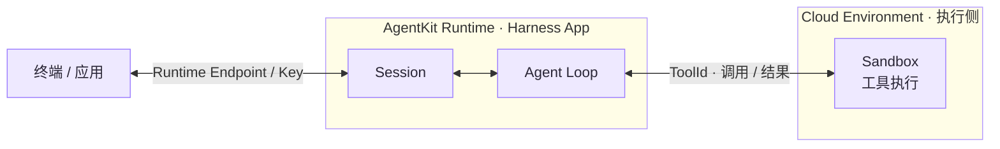
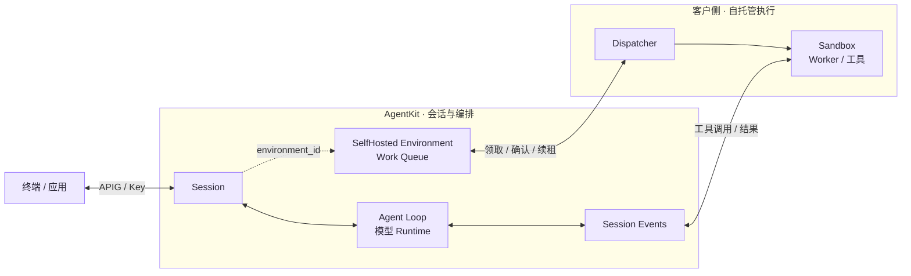
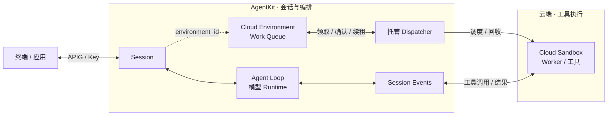

# AgentKit Infra：Direct、Queue SelfHosted 与 Queue Cloud

## 概述

三个案例都从创建控制面资源开始，最终在同一 Session 中完成流式对话。选择模式时，要看 **Session 保存在哪里、工具由谁调度**。`Cloud` 是 Environment 的类型，不能单凭它判断数据面走哪条链路。

`agent_infra/` 是可单独复制运行的完整项目。配置、签名客户端、IAM、资源工作流、Dispatcher 和流式客户端均在 `common/`，所有 Python 导入都在项目内完成。第三方依赖通过 `requirements.txt` 安装；本地无需其他教程目录或额外 Python SDK。运行仍需可访问的 AgentKit、IAM、APIG 和模型服务，以及相应账号权限。

| 模式 | Environment | 会话和对话入口 | 沙箱调度 |
| --- | --- | --- | --- |
| [01 Direct](01_direct_mode/README.md) | `Cloud` | Runtime Endpoint + Runtime Key；Harness App 创建 Session、执行 `/run_sse` | Harness App 按 ToolId 直接创建或复用云沙箱 |
| [02 Queue SelfHosted](02_queue_selfhost_mode/README.md) | `SelfHosted` | APIG BaseUrl + Environment API Key；创建 Session、提交消息并订阅事件 | 自托管 Dispatcher 消费 Work，启动或复用工具实例 |
| [03 Queue Cloud（进阶）](advanced/03_queue_cloud_mode/README.md) | `Cloud` | APIG BaseUrl + Environment API Key；创建 Session、提交消息并订阅事件 | 平台托管 Dispatcher 消费 Work，调度云沙箱 |

### 01 Direct

Session 与 Agent Loop 位于 Harness App，工具由 Agent Loop 直接调用。对应 Deployment Cloud 的执行路径。



### 02 Queue SelfHosted

AgentKit 会话服务保存 Session 与事件；自托管 Dispatcher 领取工具 Work，由客户侧 Sandbox 执行。



队列模式的模型 Runtime 是独立部署的 AgentKit Runtime，画在编排区域内表示逻辑关系。实线表示调用或事件交互，虚线表示 Session 对 Environment 的关联。

## 核心功能

1. `CreateRoute`：已有 Ready Endpoint 时复用，无可复用 Endpoint 时创建。Direct 演示这个控制面步骤，但后续对话不使用这个 Route。
2. `CreateEnvironment`：根据模式创建 Cloud 或 SelfHosted。Cloud 等待自动创建的 Sandbox Ready；SelfHosted 只登记环境。
3. `CreateRuntimeTemplate`：先准备 SessionStore、执行角色；队列模式还创建 Harness。模板接口返回 `RuntimeId` 后，用 `GetRuntime` 等待 Ready。
4. `CreateSession`：Direct 在 Harness App 创建；队列模式先创建 Environment API Key，再通过 APIG 创建。
5. `run-sse`：Direct 请求 `/run_sse`；队列模式把用户消息提交到 `/events`，再按回执的序号订阅 `/events/stream`，避免把历史回复误认成本轮输出。

## Agent 能力

三个案例均展示连续对话，可用内置沙箱工具完成一个简单检查。Direct 的工具配置由 Harness App 接管；两个队列案例使用 AgentKit Harness 的工具配置。

模型、MCP 与 Skill 统一配置在 `agent_infra/config.yaml` 的 `harness` 下：

模型配置三个模式共用；Skill 和 MCP 仅由 01 Direct Cloud 使用。02/03 Queue 使用模型和沙箱工具，共享 YAML 中的 Skill、MCP 及 MCP 工具绑定会被跳过。

| 配置 | Direct Cloud | Queue SelfHosted | Queue Cloud |
| --- | --- | --- | --- |
| `model` | 写入 Harness App Runtime；使用显式 Key 或 Runtime IAM | 模型 ID / 地址写入 Harness，Session 关联方舟 Key 名称 | 与 Queue SelfHosted 相同 |
| `mcp_servers` | Harness App Agent Loop 直接请求远程 MCP | 不使用，创建 Harness 时传空 McpServers | 不使用，创建 Harness 时传空 McpServers |
| `skills` | 写入 `SKILLS`，由 Harness App 加载 | 跳过，创建 Harness 时传空 Skills | 跳过，创建 Harness 时传空 Skills |

```yaml
harness:
  model:
    provider: openai
    agent_name: doubao-seed-evolving
    api_base: https://ark.cn-beijing.volces.com/api/v3
    api_key_name: your-ark-key-name
    api_key: "" # 仅 Direct 可提供显式 Key；留空使用 Runtime IAM
    project_name: default
  skills: [] # Direct 可填写 Skill Hub slug 或 ss-空间ID[:s-技能ID]
  mcp_servers: # 仅 01 Direct
    - name: docs
      endpoint: https://your-mcp-host/mcp
      protocol: streamable-http
```

将示例地址和 Key 名称替换为实际值。Direct 的 MCP 请求发自 Harness App Runtime，因此该 Runtime 必须能访问目标 MCP 服务。

Direct 支持 `streamable-http`、`sse` 和可选的 `api_key: "${DOCS_MCP_API_KEY}"`（Bearer）。

Direct 的 `skills` 接受 Skill Hub slug、`ss-空间ID` 或 `ss-空间ID:s-技能ID` 字符串引用，Runtime 镜像须包含对应的 Skill 加载依赖。当前配置适配不支持 `external_skill_package` / `public_url` ZIP 对象，也不会下载或校验 Skill 内容；部署后须结合 Runtime 日志或技能文件的真实读取结果确认加载成功。默认镜像的线上验证与加载路径见[Direct 使用说明](01_direct_mode/README.md#mcp-与-skill-使用)。两个 Queue 模式不会加载这些 Skill。

`runtime_template.envs` 用于其他 Runtime 设置。模型、MCP、Skill 的环境变量由配置适配器生成，重复配置会报错；不要把这些字段同时写入 `envs`。修改 YAML 后须清理并重新创建相应资源，已创建的 Runtime、Harness 和 Session 不会自动更新。

## 目录结构说明

```text
agent_infra/
├── 01_direct_mode/
├── 02_queue_selfhost_mode/
├── advanced/
│   └── 03_queue_cloud_mode/
└── common/                   # 共享编排和两类 SSE 客户端
```

## 本地运行

在 `agent_infra/` 下执行：

```bash
uv venv --python 3.12
source .venv/bin/activate
uv pip install -r requirements.txt --default-index https://mirrors.aliyun.com/pypi/simple/
python 01_direct_mode/run.py create-environment --dry-run
```

已有教程虚拟环境时跳过 `uv venv`。`--dry-run` 不读取配置、不访问网络，也不创建资源。

## AgentKit 部署

三个模式都读取 `agent_infra/config.yaml`。在 `agent_infra/` 目录下准备一次即可：

```bash
test -f config.yaml ||
  install -m 600 config.yaml.example config.yaml
```

填写账号凭据（或通过环境变量提供）、模型 ID 和模型地址。如果没有账号 Endpoint，填写 `route.apig_gateway_id`；有多个时指定 `route.endpoint_id`。Workspace 使用顶层 `workspace_id`，SessionStore 网络和执行角色按实际环境配置。队列模式在创建 Harness 前须填写 `harness.model.api_key_name`，即方舟 Key 的名称。Direct 使用 `harness.model.api_key` 或 Runtime IAM，填写 Key 名称时按名称取 Key；镜像要求见该模式教程。`${变量名}` 在本地执行命令时解析，因此应在创建 Runtime 前设置相应环境变量。

顶层 `route` 描述 APIG Endpoint 的复用和创建参数。API 调用凭据留在 `volcengine`，Runtime、Environment、SessionStore 的规格和网络留在各自配置段。旧的 `environment` 下的 Route 字段仍兼容读取，但不能与顶层 `route` 配置不同值。

实际运行会创建计费资源。三个样例只读取共享 YAML；各模式各自的 `.local/` 子目录只保存运行状态。队列模式首次签发的 Environment Key 保存于权限为 `0600` 的 `environment-key.json`，清理成功后移除。共享 YAML 和运行状态均不纳入版本管理。

### 三模式使用命令

以下命令均在 `agent_infra/` 目录下、已激活的虚拟环境中逐条执行；每步成功后再执行下一步。先填好共享 YAML，再选择所需模式。已有本轮资源时，可继续执行尚未完成的步骤；要应用新的模型配置，或更新 Direct 的 MCP、Skill，先完成该模式的清理，再按下面的顺序重建。

预览三个模式的资源创建入口：

```bash
python 01_direct_mode/run.py create-environment --dry-run
python 02_queue_selfhost_mode/run.py create-environment --dry-run
python advanced/03_queue_cloud_mode/run.py create-environment --dry-run
```

`--dry-run` 只预览调用计划，不校验 YAML 或验证远程能力。

Direct Cloud：

```bash
python 01_direct_mode/run.py create-environment
python 01_direct_mode/run.py create-session-store
python 01_direct_mode/run.py create-runtime-template
python 01_direct_mode/run.py create-session
python 01_direct_mode/run.py run-sse --prompt "请只回复 DIRECT_OK"
python 01_direct_mode/run.py run-sse --prompt "上一轮我要求你回复什么？只输出标记。"
```

Queue SelfHosted：

```bash
python 02_queue_selfhost_mode/run.py create-route
python 02_queue_selfhost_mode/run.py create-environment
python 02_queue_selfhost_mode/run.py create-harness
python 02_queue_selfhost_mode/run.py create-session-store
python 02_queue_selfhost_mode/run.py create-runtime-template
python 02_queue_selfhost_mode/run.py create-api-key
python 02_queue_selfhost_mode/run.py dispatcher
python 02_queue_selfhost_mode/run.py create-session
python 02_queue_selfhost_mode/run.py run-sse --prompt "请只回复 SELFHOST_OK"
python 02_queue_selfhost_mode/run.py run-sse --prompt "上一轮我要求你回复什么？只输出标记。"
```

Queue Cloud（须先开通平台托管队列能力）：

```bash
python advanced/03_queue_cloud_mode/run.py create-route
python advanced/03_queue_cloud_mode/run.py create-environment
python advanced/03_queue_cloud_mode/run.py create-harness
python advanced/03_queue_cloud_mode/run.py create-session-store
python advanced/03_queue_cloud_mode/run.py create-runtime-template
python advanced/03_queue_cloud_mode/run.py create-api-key
python advanced/03_queue_cloud_mode/run.py create-session
python advanced/03_queue_cloud_mode/run.py run-sse --prompt "请只回复 QUEUE_CLOUD_OK"
python advanced/03_queue_cloud_mode/run.py run-sse --prompt "上一轮我要求你回复什么？只输出标记。"
```

### MCP 与 Skill 验证命令

以下验证命令仅用于 01 Direct。先在 YAML 中填写实际的 `harness.mcp_servers`，完成 Direct 资源和会话创建，再执行验证命令。下面使用共享配置示例中的 `docs` 服务；若服务名不同，替换提示词中的名称。根据该 MCP 实际提供的工具，补充查询参数。

```bash
python 01_direct_mode/run.py run-sse --prompt "请实际调用已配置的 docs MCP 的一个只读工具，给出工具名称和真实返回结果。"
```

Skill 仅在 Direct 验证。将已有的有效 Hub/Space 引用填入 YAML，例如在 `harness.skills` 列表中添加实际的 Skill Hub slug，然后创建 Direct Runtime 和会话。将下面的 `your-skill-hub-slug` 和任务描述替换为实际技能及其支持的任务：

```bash
python 01_direct_mode/run.py run-sse --prompt "请加载并遵循 your-skill-hub-slug 技能，完成该技能支持的一项任务，说明你读取的技能说明和实际执行结果。"
```

如果 Direct 的模型或 MCP Key 使用 YAML 中的环境变量引用，在创建 Runtime 前设置对应变量。例如配置了 `harness.model.api_key: "${MODEL_API_KEY}"` 和 MCP 的 `api_key: "${DOCS_MCP_API_KEY}"` 时，在 Bash 中执行：

```bash
read -r -s -p "Direct 模型 API Key: " MODEL_API_KEY
export MODEL_API_KEY
read -r -s -p "Direct MCP Bearer Key: " DOCS_MCP_API_KEY
export DOCS_MCP_API_KEY
```

仅使用 Runtime IAM 或无鉴权 MCP 时无需设置这些变量。验证时须核对 SSE 中的真实工具调用与结果；Skill 可通过加载日志或读取实际技能文件确认，加载工具的名称取决于镜像实现。模型口头声称“已调用”或“已加载”不能代替验证。

### 清理与配置重建

按实际使用的模式执行。SelfHosted 须先按[该模式的清理说明](02_queue_selfhost_mode/README.md#清理资源)停止并回收 Dispatcher、工具实例及本轮独占的 Tool 模板，然后再执行其 `cleanup`：

```bash
python 01_direct_mode/run.py cleanup
python 02_queue_selfhost_mode/run.py cleanup
python advanced/03_queue_cloud_mode/run.py cleanup
```

完成清理后，编辑共享 `config.yaml`，重新执行所选模式的完整创建顺序。Direct 可继续运行 MCP 或 Skill 验证命令；Queue 使用上面的模型对话和各模式教程中的沙箱验证。配置不支持对已有 Runtime、Harness 或 Session 热更新。

## 示例提示词

先发「请只回复 AGENT_INFRA_OK」，再用同一 Session 发「上一轮我要求你回复什么？只输出那个标记」。工具试跑请参考各模式的示例词。

## 效果展示

`create-session` 输出所属数据面的 SessionId。`run-sse` 逐条输出 JSON 事件：Direct 输出 ADK 事件；队列模式输出会话服务持久化的事件，并在收到本轮回复及 `end_turn` 后退出。验收沙箱时应核对工具调用和工具结果，不能只看模型回复。

## 进阶模式：03 Queue Cloud

[Queue Cloud 完整案例](advanced/03_queue_cloud_mode/README.md) 使用平台托管队列。会话链路与 SelfHosted 相同，Dispatcher 位于 AgentKit 会话与编排服务中，由平台负责领取 Work、调度 Sandbox 及异步回收。用户无需单独部署 Dispatcher，使用前须确认目标账号和地域已开通此能力。



## 常见问题

- `/list-apps` 不包含 `harness_agent`：检查 Direct Runtime 镜像；通常是 Runtime 不兼容或选错了 Endpoint。
- 会话事件流没有工具结果：SelfHosted 检查自建 Dispatcher 和目标 EnvironmentId；Queue Cloud 检查平台 Dispatcher 是否已为账号开通。
- 事件流中断：先查看本轮事件及会话状态，再决定是否重发，避免重复执行。
- 结束后运行对应案例的 `cleanup`。Route 和 IAM 角色可能被其他样例共用，因此保留；SelfHosted Dispatcher 和 Tool 模板须先按案例说明清理。

## 代码许可

本示例遵循 [Apache 2.0 License](../../../../LICENSE)。
