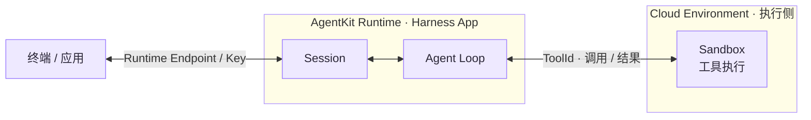
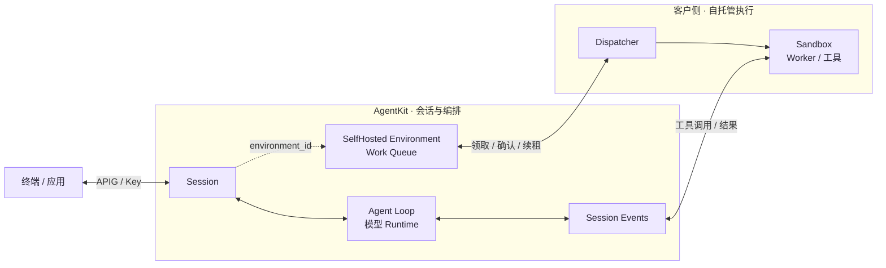
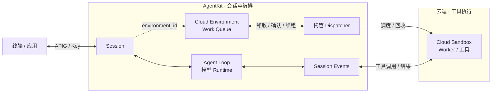

# AgentKit Infra：Direct、Queue SelfHosted 与 Queue Cloud

## 概述

三个案例都从创建控制面资源开始，最终在同一 Session 中完成流式对话。选择模式时，要看 **Session 保存在哪里、工具由谁调度**。`Cloud` 是 Environment 的类型，不能单凭它判断数据面走哪条链路。

| 模式 | Environment | 会话和对话入口 | 沙箱调度 |
| --- | --- | --- | --- |
| [01 Direct](01_direct_mode/README.md) | `Cloud` | Runtime Endpoint + Runtime Key；Harness App 创建 Session、执行 `/run_sse` | Harness App 按 ToolId 直接创建或复用云沙箱 |
| [02 Queue SelfHosted](02_queue_selfhost_mode/README.md) | `SelfHosted` | APIG BaseUrl + Environment API Key；创建 Session、提交消息并订阅事件 | 自托管 Dispatcher 消费 Work，启动或复用工具实例 |
| [03 Queue Cloud（进阶）](advanced/03_queue_cloud_mode/README.md) | `Cloud` | APIG BaseUrl + Environment API Key；创建 Session、提交消息并订阅事件 | 平台托管 Dispatcher 消费 Work，调度云沙箱 |

### 01 Direct

Session 与 Agent Loop 位于 Harness App，工具由 Agent Loop 直接调用。对应 Deployment Cloud 的执行路径。



### 02 Queue SelfHosted

AgentKit 会话服务保存 Session 与事件；自托管 Dispatcher 领取工具 Work，由客户侧 Sandbox 执行。



队列模式的模型 Runtime 是独立部署的 AgentKit Runtime，画在编排区域内表示逻辑关系。实线表示调用或事件交互，虚线表示 Session 对 Environment 的关联。

## 核心功能

1. `CreateRoute`：已有 Ready Endpoint 时复用，无可复用 Endpoint 时创建。Direct 演示这个控制面步骤，但后续对话不使用这个 Route。
2. `CreateEnvironment`：根据模式创建 Cloud 或 SelfHosted。Cloud 等待自动创建的 Sandbox Ready；SelfHosted 只登记环境。
3. `CreateRuntimeTemplate`：先准备 SessionStore、执行角色；队列模式还创建 Harness。模板接口返回 `RuntimeId` 后，用 `GetRuntime` 等待 Ready。
4. `CreateSession`：Direct 在 Harness App 创建；队列模式先创建 Environment API Key，再通过 APIG 创建。
5. `run-sse`：Direct 请求 `/run_sse`；队列模式把用户消息提交到 `/events`，再按回执的序号订阅 `/events/stream`，避免把历史回复误认成本轮输出。

## Agent 能力

三个案例均展示连续对话，可用内置沙箱工具完成一个简单检查。Direct 的工具配置由 Harness App 接管；两个队列案例使用 AgentKit Harness 的工具配置。

## 目录结构说明

```text
agent_infra/
├── 01_direct_mode/
├── 02_queue_selfhost_mode/
├── advanced/
│   └── 03_queue_cloud_mode/
└── common/                   # 共享编排和两类 SSE 客户端
```

## 本地运行

在 `agent_infra/` 下执行：

```bash
uv venv --python 3.12
source .venv/bin/activate
uv pip install -r requirements.txt --default-index https://mirrors.aliyun.com/pypi/simple/
python 01_direct_mode/run.py create-environment --dry-run
```

已有教程虚拟环境时跳过 `uv venv`。`--dry-run` 不读取配置、不访问网络，也不创建资源。

## AgentKit 部署

三个模式都读取 `agent_infra/config.yaml`。在 `agent_infra/` 目录下准备一次即可：

```bash
test -f config.yaml ||
  install -m 600 config.yaml.example config.yaml
```

填写账号凭据（或通过环境变量提供）、模型 ID 和模型地址。如果没有账号 Endpoint，填写 `environment.apig_gateway_id`；有多个时指定 `environment.endpoint_id`。Workspace、SessionStore 网络和执行角色按实际环境配置。队列模式还须填写 `harness.model.api_key_name`，即方舟 Key 的名称。Direct 的模型凭据及镜像要求见该模式教程。

实际运行会创建计费资源。三个样例只读取共享 YAML；各模式各自的 `.local/` 子目录只保存运行状态。队列模式首次签发的 Environment Key 保存于权限为 `0600` 的 `environment-key.json`，清理成功后移除。共享 YAML 和运行状态均不纳入版本管理。

## 示例提示词

先发「请只回复 AGENT_INFRA_OK」，再用同一 Session 发「上一轮我要求你回复什么？只输出那个标记」。工具试跑请参考各模式的示例词。

## 效果展示

`create-session` 输出所属数据面的 SessionId。`run-sse` 逐条输出 JSON 事件：Direct 输出 ADK 事件；队列模式输出会话服务持久化的事件，并在收到本轮回复及 `end_turn` 后退出。验收沙箱时应核对工具调用和工具结果，不能只看模型回复。

## 进阶模式：03 Queue Cloud

[Queue Cloud 完整案例](advanced/03_queue_cloud_mode/README.md) 使用平台托管队列。会话链路与 SelfHosted 相同，Dispatcher 位于 AgentKit 会话与编排服务中，由平台负责领取 Work、调度 Sandbox 及异步回收。用户无需单独部署 Dispatcher，使用前须确认目标账号和地域已开通此能力。



## 常见问题

- `/list-apps` 不包含 `harness_agent`：检查 Direct Runtime 镜像；通常是 Runtime 不兼容或选错了 Endpoint。
- 会话事件流没有工具结果：SelfHosted 检查自建 Dispatcher 和目标 EnvironmentId；Queue Cloud 检查平台 Dispatcher 是否已为账号开通。
- 事件流中断：先查看本轮事件及会话状态，再决定是否重发，避免重复执行。
- 结束后运行对应案例的 `cleanup`。Route 和 IAM 角色可能被其他样例共用，因此保留；SelfHosted Dispatcher 和 Tool 模板须先按案例说明清理。

## 代码许可

本示例遵循 [Apache 2.0 License](../../../../LICENSE)。
